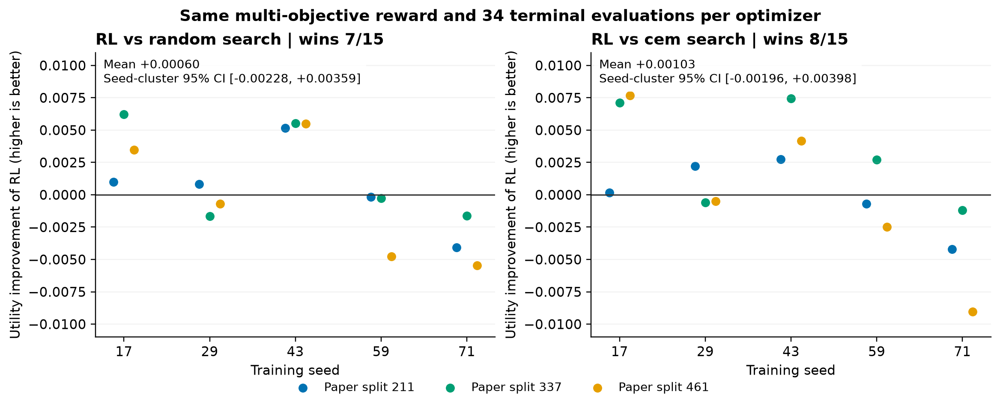
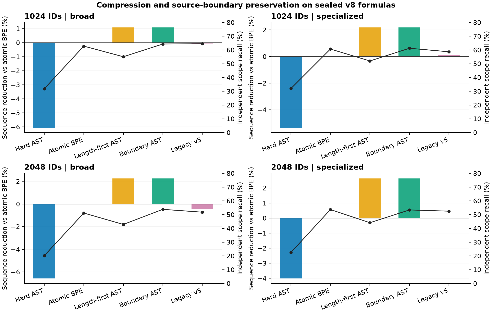

# v8：进入下游前的最终本征分词器实验

本轮先写定RL实用晋升门槛、相同终端奖励与评分预算、AST边界开发网格、最终比较和下游角色，再评分新增封存测试。完整保留失败种子、搜索控制及历史基准。最终结论针对当前独立分词器，不能推广为所有RL或语言模型内端到端RL没有作用。

新测试包含4,294条公式，27篇论文贡献，30篇许可核验源码被获取，来源领域外子集1,428条。预先目标32篇，元数据候选中实际取得30篇；领域覆盖有限，未按模型分数补样本。固定2020年前版本、源码许可、宏变换、领域和simple/complex证据均保留，历史人工来源仍是年代推断。

正式121种配置、682组指标、1,446,368行结果；九种成熟tokenizer全部同原式评测。除了新测试，还统一重跑暴露的v7/v6自然和来源领域外测试、521式压力集。共8轮协议/结果审查、201项测试通过。七轮交错公共encode/decode，包括codec和前端。旧测试报告不称新未见泛化。

## RL：同奖励、同预算的实用去留

新候选采样完整24维合并策略，用相同两个训练任务上实际导出的词表终端回报进行Gaussian score-function更新，避免把几百次动作score相加。固定随机搜索和CEM搜索共享同初始化、候选特征、目标容量及多目标回报；每算法17个候选×2任务=34次终端评分，均按训练内回报选择最佳已评分候选。关闭更新单列，不伪装成同样计算量。允许信息和评分次数一致，实际耗时并不完全相同。

三个按论文分离的来源划分×五训练种子；这些属于以前可访问的开发来源。晋升要求相对两种搜索均至少0.5%平均utility改善、15组中至少12胜、种子重采样区间支持改善，并满足压缩/边界完整性非劣约束。区间条件于三次可能重叠来源划分，不能把十五组当成完全独立来源实验。

|对照|utility相对改善↑|15组胜数|种子聚类95%区间（绝对utility改善）|核心非劣界|晋升|
|---|---:|---:|---|---|---|
|固定随机搜索|0.116%|7/15|[-0.002281, 0.003593]|未通过|未通过|
|交叉熵搜索|0.199%|8/15|[-0.001963, 0.003982]|未通过|未通过|

RL没有通过固定的实用晋升门槛，最终生产及下游核心名单去掉RL。保存旧RL及本轮所有候选，作为诊断和负面结果复现。不是从磁盘抹去失败证据，也不是证明所有RL无效。

四个完整训练场景另各训练三个种子，实际目标容量1024/2048，不再只从较小容量任务迁移；三算法共享相同奖励和34次评分。正式新测试全部报告，不选幸运seed。

## AST：参数边界与压缩取舍

新路径的代价为token数＋native partial-crossing代价＋被token跨过的源码brace内容端点代价。它只读取原文，推断不加载KaTeX/pylatexenc参考。边界权重在共同旧dev的固定12项网格选择，所有场景选tree=.25、boundary=.3；独立pylatexenc作为不同实现的语法诊断，仍非专家数学语义gold。字典和原子与原版同原子BPE完全一致。

|预算|场景|方法|paper token/byte↓|KaTeX crossing%↓|独立参数边界召回%↑|命令完整%↑|编码MiB/s↑|
|---:|---|---|---:|---:|---:|---:|---:|
|1024|broad|AST-v4 原版|0.41814|7.31|31.84|97.84|31.50|
|1024|broad|v5 原版|0.39454|19.78|64.56|99.76|10.19|
|1024|broad|同原子原版BPE|0.39430|19.26|62.83|99.76|10.20|
|1024|broad|AST 两级最短路径|0.39002|17.73|55.11|99.76|32.74|
|1024|broad|AST 参数边界路径|0.39002|18.43|64.36|99.76|29.68|
|1024|broad|参数级终端RL|0.39557|18.41|58.03|99.76|9.79|
|1024|broad|固定随机搜索|0.39537|18.66|60.66|99.76|10.07|
|1024|broad|交叉熵搜索|0.39841|17.77|53.87|99.76|9.51|
|1024|specialized|AST-v4 原版|0.47083|6.23|31.98|96.97|28.85|
|1024|specialized|v5 原版|0.44650|16.40|58.71|96.97|9.22|
|1024|specialized|同原子原版BPE|0.44697|16.77|60.70|96.97|9.68|
|1024|specialized|AST 两级最短路径|0.43722|14.30|52.04|96.97|29.20|
|1024|specialized|AST 参数边界路径|0.43722|15.11|61.27|96.97|28.15|
|1024|specialized|参数级终端RL|0.44828|15.92|55.34|96.97|9.35|
|1024|specialized|固定随机搜索|0.45071|15.67|59.60|96.97|9.71|
|1024|specialized|交叉熵搜索|0.44753|15.99|56.75|96.97|9.54|
|2048|broad|AST-v4 原版|0.35936|10.14|20.20|97.84|31.23|
|2048|broad|v5 原版|0.33870|25.32|51.80|99.76|9.57|
|2048|broad|同原子原版BPE|0.33719|24.87|51.18|99.76|9.56|
|2048|broad|AST 两级最短路径|0.32955|23.31|42.90|99.76|31.81|
|2048|broad|AST 参数边界路径|0.32959|24.17|53.87|99.76|28.65|
|2048|broad|参数级终端RL|0.33982|24.64|51.35|99.76|10.18|
|2048|broad|固定随机搜索|0.33736|24.76|49.28|99.76|10.13|
|2048|broad|交叉熵搜索|0.33822|24.77|48.87|99.76|9.52|
|2048|specialized|AST-v4 原版|0.42838|6.90|22.45|96.97|29.63|
|2048|specialized|v5 原版|0.41175|19.12|52.54|96.97|9.48|
|2048|specialized|同原子原版BPE|0.41185|18.83|53.72|96.97|9.34|
|2048|specialized|AST 两级最短路径|0.40097|15.93|44.14|96.97|29.47|
|2048|specialized|AST 参数边界路径|0.40097|17.06|53.43|96.97|24.72|
|2048|specialized|参数级终端RL|0.41149|18.65|53.01|96.97|9.50|
|2048|specialized|固定随机搜索|0.41147|18.31|51.43|96.97|9.47|
|2048|specialized|交叉熵搜索|0.41200|19.17|53.44|96.97|9.58|

新版必须同时看compression、KaTeX crossing与另一组边界指标。低crossing或高边界召回各自都可能被退化分词获得；不能据其中一项证明整体数学语义更好。全量独立指标、解析覆盖、局部编辑、平滑敏感性、Rényi效率、词表使用及长尾长度均在metrics.json。

按论文聚类200,000次重采样，主要比较×六核心计数指标共144项，报告Bonferroni家族95%区间。下面均为AST边界路径减同原子BPE；长度与crossing负值有利，边界recall正值有利。区间条件于保存的词表及已观察训练seed。

|预算/场景|paper token/byte差：家族95%CI|参数边界召回差pp：家族95%CI|crossing差pp：家族95%CI|
|---|---|---|---|
|1024/broad|-0.00428 [-0.00601, -0.00270]|+1.52827 [-2.35993, +6.06462]|-0.82643 [-2.19621, -0.02300]|
|1024/specialized|-0.00976 [-0.02916, -0.00197]|+0.56756 [-4.44490, +9.88417]|-1.65953 [-6.63584, +0.66184]|
|2048/broad|-0.00760 [-0.01106, -0.00535]|+2.68360 [+0.48945, +6.58901]|-0.69837 [-2.00604, +0.58730]|
|2048/specialized|-0.01088 [-0.03025, -0.00344]|-0.28378 [-5.78204, +12.17246]|-1.77005 [-7.42553, +0.71012]|

四场景压缩差的家族区间均支持改善；边界与crossing的部分区间跨零，不能将全部点估计改善说成稳定显著优势。极端来源域的论文数较少，区间更宽，来源领域标签也不等同于完全不同数学概念。

完整语料C++索引在4000条fit、1024目标容量、五轮交错完整词表构建对照上加速4.25倍，词表/合并/策略score完全一致。该计时包括codec、特征、计数及原版BPE构建，排除终端奖励评估；不解释成学习收益或完整RL同倍加速。

## 去掉RL的替代核验

同原子原版BPE作为最简单的非RL生产候选。它是原版BPE加数学词法原子的对照/替代，不包装成原创RL算法。评分前固定的容忍界：压缩相对1%、BPB相对2%、命令/数字/独立边界召回与crossing绝对1个百分点、编码速度降低10%。满足点估计界与证明统计等价分开。

|预算/场景|压缩相对退化%↓|BPB相对退化%↓|参数边界召回损失pp↓|crossing增加pp↓|速度相对损失%↓|全部点估计界|压缩家族CI非劣|
|---|---:|---:|---:|---:|---:|---|---|
|1024/broad|-0.062|0.020|1.732|-0.523|-0.128|未通过|支持|
|1024/specialized|0.107|-0.108|-1.986|0.372|-5.002|通过|不支持|
|2048/broad|-0.446|-0.211|0.613|-0.447|0.037|通过|支持|
|2048/specialized|0.024|-0.291|-1.181|-0.290|1.509|通过|不支持|

完整命令/数字差、配对压缩区间及每一容忍界见non_RL_replacement.json；多指标普通与家族调整区间见multimetric_paired_effects.json。某些界若未通过，不能声称去掉RL后各指标完全保持。工程去留依据无稳定学习收益和明确角色；旧v5留为下游诊断消融，避免掩盖结构取舍。

已冻结AST边界分支与父v5的替代差另外作描述性核验，见AST_non_RL_replacement_descriptive.json。该比较未追加为主要预注册假设，不用它重新选择模型或宣称统计等价。两者的词表及分词规则不同，结果支持完整非RL替代系统的实用指标，不能将全部差异归因于单独删除RL。

|AST替代父v5：预算/场景|压缩相对退化%↓|参数边界召回损失pp↓|crossing增加pp↓|所有核心点估计容忍界|
|---|---:|---:|---:|---|
|1024/broad|-1.146|0.203|-1.350|通过|
|1024/specialized|-2.078|-2.554|-1.287|通过|
|2048/broad|-2.690|-2.071|-1.146|通过|
|2048/specialized|-2.619|-0.897|-2.060|通过|

## 完整排名

综合分沿用冻结权重：压缩30%、编码25%、KaTeX crossing20%、命令10%、数字5%、fit BPB10%；broad和specialized各50%。百分位综合排序依赖参赛集合，不能当作算法贡献或下游结论。另提供全部单指标排名、Pareto和速度权重敏感性。

### 1024预算与成熟原版词表

|综合位置|方法|综合分↓|广域压缩名次|严格跨来源域压缩名次|
|---:|---|---:|---:|---:|
|1|AST 两级最短路径|0.0712|1|1|
|2|AST 参数边界路径|0.1255|3|1|
|3|AST-v4 原版|0.2386|12|12|
|4|同原子原版BPE|0.2739|4|5|
|5|固定随机搜索|0.3005|6|8|
|6|v5 原版|0.3054|5|4|
|7|交叉熵搜索|0.3212|8|6|
|8|参数级终端RL|0.3255|7|7|
|9|同原子词表PathPiece|0.3484|1|1|
|10|v5 终端RL迁移|0.3511|9|9|
|11|SentencePiece Unigram|0.5245|17|17|
|12|byte词表PathPiece|0.5462|10|10|
|13|GPT-2|0.5826|24|24|
|14|SentencePiece BPE|0.5902|16|15|
|15|o200k|0.5902|18|18|
|16|原版byte BPE|0.6114|11|13|
|17|cl100k|0.6272|20|20|
|18|DeepSeek-V3|0.7011|13|11|
|19|Llama 3|0.7054|19|19|
|20|WordPiece|0.7130|15|16|
|21|Mistral-Nemo|0.7283|14|14|
|22|Phi-4|0.7511|20|20|
|23|Qwen2.5|0.8261|22|22|
|24|Qwen3|0.8413|22|22|

### 2048预算与成熟原版词表

|综合位置|方法|综合分↓|广域压缩名次|严格跨来源域压缩名次|
|---:|---|---:|---:|---:|
|1|AST 两级最短路径|0.1016|2|1|
|2|AST 参数边界路径|0.1408|3|1|
|3|AST-v4 原版|0.2337|12|12|
|4|固定随机搜索|0.3109|5|5|
|5|参数级终端RL|0.3348|9|6|
|6|v5 终端RL迁移|0.3424|10|10|
|7|交叉熵搜索|0.3630|6|9|
|8|同原子原版BPE|0.3641|4|8|
|9|v5 原版|0.3799|7|7|
|10|同原子词表PathPiece|0.4147|1|1|
|11|SentencePiece Unigram|0.5043|17|17|
|12|o200k|0.5380|18|18|
|13|SentencePiece BPE|0.5516|14|15|
|14|byte词表PathPiece|0.5620|8|4|
|15|GPT-2|0.5685|24|24|
|16|cl100k|0.5793|20|20|
|17|原版byte BPE|0.6136|11|11|
|18|Llama 3|0.6576|19|19|
|19|Phi-4|0.6924|20|20|
|20|DeepSeek-V3|0.7141|15|14|
|21|WordPiece|0.7266|13|13|
|22|Mistral-Nemo|0.7418|16|16|
|23|Qwen2.5|0.7745|22|22|
|24|Qwen3|0.7897|22|22|

## 冻结的下游候选

名单角色在首次v8评分前冻结。相同容量研究组使用同训练信息，成熟模型保留其实际官方词表，后续须披露embedding/softmax参数及字节/算力预算，不能把不同容量误称严格等参。新旧分词器均可独立加载，无语言模型集成或下游训练。

|角色|方法|用途|
|---|---|---|
|数学核心|AST参数边界路径、原版硬AST、同原子原版BPE|边界/压缩折中、严格结构、非RL数学原子对照|
|相同容量控制|原版byte BPE、SentencePiece Unigram|传统算法及Unigram控制|
|成熟通用核心|Qwen2.5、Llama 3、o200k|不同主流官方分词机制，实际词表容量单列|
|结构必要消融|AST两级长度优先路径、作者PathPiece|区分边界代价、最短路径与实现贡献|
|扩展通用|Qwen3、DeepSeek-V3、Phi-4、Mistral-Nemo、GPT-2、cl100k|兼容/部署参考，完整本征结果已包含|
|学习诊断|父v5、终端RL、随机搜索、CEM、关闭更新|RL必要性复核，核心RL是否纳入依预定开发门槛|

每个角色准确检查点、sha256、容量/场景及三seed中的固定部署seed17，见models/final_intrinsic/registry.json；入口：from math_tokenizer.final_models import load_final。训练采用原版官方BPE的非RL路线，不隐含调用RL生成生产词表。

## 公平性与限制

评分前四轮检查：来源及同reward/34评分预算；公共接口异常输入与所有ID容量；同字典/原子和穷举/数值梯度；固定模型、原版第三方及完整测试。评分后四轮：每组全量输入/聚合；每个公共encoder逐式重放原文/payload/参考指标；七轮计时与作者信息指标；同约束路径原理核验。另复核学习与搜索所有日志和三来源重划分保存模型。

各方法实际wall-clock训练耗时和历史超参搜索不同。九种成熟tokenizer预训练污染未知，近期新来源并不意味着概念完全不重合。新测试覆盖有限且领域不均。源码边界指标已进入本轮AST开发，所以独立实现不等于完全未针对它优化。专家双审完成0，80条新测试待审材料已准备，未执行第二硬件或独立团队复现。没有下游任务结果。

本轮作为最后一次本征大规模封存实验；v8测试现在已暴露。后续重点转为固定候选的下游协议和实验，不能继续用此测试挑新的分词配置。

复现入口：sh scripts/run_v8_replay.sh。协议：docs/v8_preregistered_protocol.md；主结果：results/v8/full/metrics.json、all_main_metrics.csv、rankings.json、multimetric_paired_effects.json；逐式结果：per_formula.jsonl.gz；核验：results/v8/verification.json。
