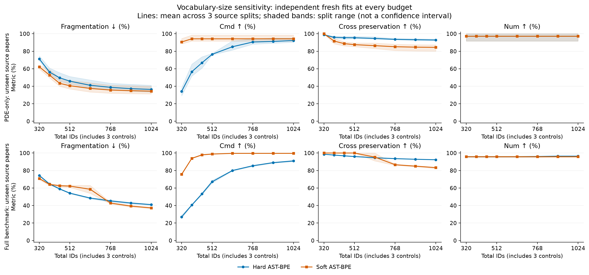
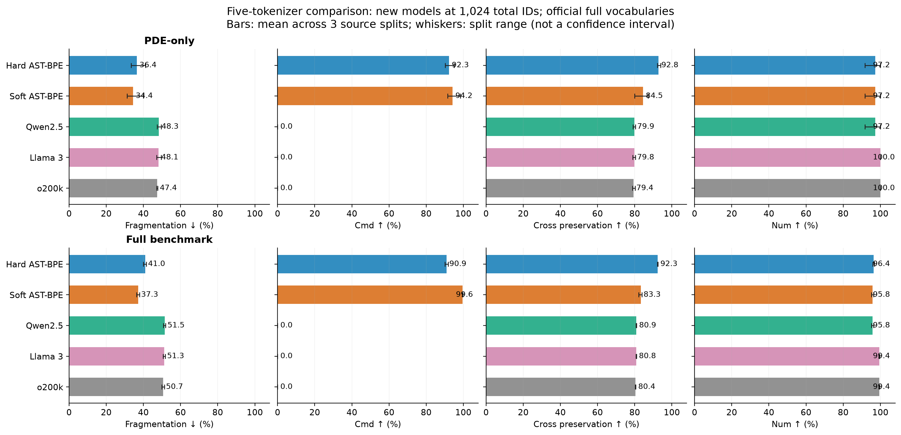
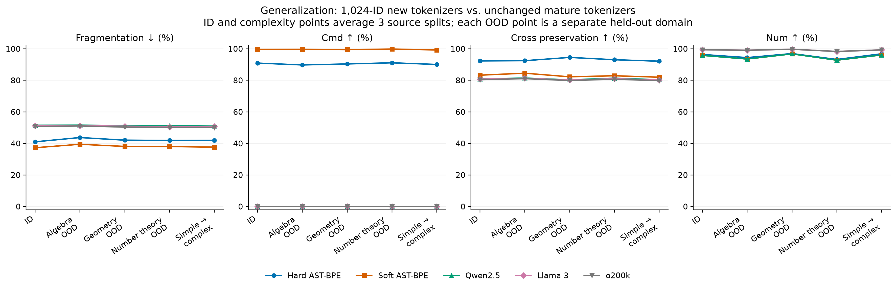

# ZIP 两种 AST-BPE：从零训练的四指标实验

本报告只研究 ZIP 中的 Hard AST-BPE（`ast_bpe`）、Soft AST-BPE（`soft_ast_bpe`），与 Qwen2.5、Llama 3、o200k 对比。所有自研词表都在对应训练集上、按每个容量独立从零学习。未载入 ZIP 内的已有词表，未使用旧自研模型的训练检查点。

## 1. 指标与预先固定的比较方法

| 指标 | 定义 | 方向 |
|---|---|---|
| 破坏率／切分率 | $100\sum_i(T_i-1)/\sum_i(B_i-1)$，其中 $B_i$ 为 UTF-8 字节数，$T_i$ 为内容 token 数 | ↓ |
| Cmd | 内部没有 token 边界的 `\[A-Za-z]+` 命令数／全部这类命令数 ×100 | ↑ |
| Cross 保持率 | $100(1-\mathrm{partial\ crossing\ tokens}/\mathrm{all\ tokens})$，参考为冻结的独立 KaTeX 语法跨度 | ↑ |
| Num | 内部没有 token 边界的 `[0-9]+(?:\.[0-9]+)?` 数字词素数／全部这类数字词素数 ×100 | ↑ |

统计都使用先汇总分子、分母再求比率；没有命令或数字时是 NA，不记为100。Cross 是旧 crossing rate 的补数，与旧表的方向相反。判定部分跨越：token `[a,b)` 与参考跨度 `[s,e)` 满足 `a<s<b<e` 或 `s<a<e<b`；包含、被包含、端点重合均不算 crossing。

**“破坏率”在这里严格测量切分密度，不直接等价于数学语义受损。** 例如3字节 `abc` 切为3个 token，切分率为100%；切为1个 token，切分率为0%。逐字节切分虽然 Cmd/Num 可能很差，却几乎不会部分跨越树跨度，Cross 可以得到100%。因此四指标不保证反向单调关系，不能修改定义以追求这种关系。

## 2. 数据、模型及公平性

现有冻结 catalog 共56,000条：严格 PDE 356条，其余数学55,644条。没有为本轮更改数据或分类。严格 PDE 来自20个来源组，不等于“PDE论文内的所有公式”。全量 benchmark 包含13个领域。

词表8档：320、384、448、512、640、768、896、1024。每档总ID含 PAD/EOS/BOS 三个控制ID；指标仅计算内容 token，不添加这些控制ID。两种新模型使用完全相同的训练公式，逐档独立训练。三个成熟分词器保留官方完整词表，因此本实验是实际系统质量比较，**不是同词表预算、同预训练数据的算法因果比较**。成熟模型可能见过公开数据，无法证明其预训练阶段未接触这些公式。

| 模型 | 来自何处／算法 | 实际ID空间 |
|---|---|---|
| Hard AST-BPE | ZIP 原始 `HardASTBPE`；字节初始化；结构兼容的频率合并；编码按训练合并顺序并施加硬限制 | 每档实测记录，含3控制ID |
| Soft AST-BPE | ZIP 原始 `train_one`；训练侧命令／Unicode原子 + 官方HF BPE训练；结构感知动态规划；固定 tree=.25、boundary=.30 | 每档实测记录，含3控制ID |
| Qwen2.5 | 原项目固定官方代码／词表，原样使用 | 151,665 |
| Llama 3 | 原项目固定官方代码／词表，原样使用 | 128,256 |
| o200k | 原项目固定官方代码／词表，原样使用 | 200,019 |

为避免无关的 EqGPT 数据依赖，只从原文件解析并原样执行 `train_one` 函数体；其依赖实现来自逐字节一致的 ZIP 源码快照。没有改写分词算法或训练函数。源码与 ZIP 哈希见 `zip_provenance.json`。

所有模型输入相同原字符串；不截断、不归一化、不按模型剔除公式；完整执行逐条 encode/decode 和字节重建断言。训练／验证／测试来源组隔离，且剔除训练侧与验证或测试侧相同规范公式／模板。验证集不用于建词表或选择参数，主比较容量预先固定为1024。

| 划分 | 训练 | 验证（未拟合） | 测试 | 训练侧去重剔除 |
|---|---:|---:|---:|---:|
| pde_id_17 | 249 | 36 | 71 | 0 |
| pde_id_29 | 249 | 36 | 71 | 0 |
| pde_id_43 | 250 | 35 | 71 | 0 |
| benchmark_id_17 | 38,679 | 5,544 | 11,200 | 521 |
| benchmark_id_29 | 38,696 | 5,537 | 11,200 | 504 |
| benchmark_id_43 | 38,693 | 5,532 | 11,200 | 506 |
| benchmark_ood_algebra | 47,108 | 4,003 | 4,431 | 406 |
| benchmark_ood_geometry_topology | 42,815 | 3,527 | 9,135 | 429 |
| benchmark_ood_number_theory | 46,837 | 4,447 | 4,273 | 409 |
| benchmark_simple_to_complex_17 | 25,743 | 3,740 | 3,570 | 287 |
| benchmark_simple_to_complex_29 | 25,408 | 3,867 | 3,305 | 230 |
| benchmark_simple_to_complex_43 | 25,556 | 3,676 | 3,285 | 253 |

PDE与全量ID各3个来源隔离划分；OOD分别完整留出代数、几何拓扑、数论领域，并从训练排除与该测试领域共享来源的公式；复杂度实验只使用简单公式训练，在其他来源的复杂公式上测试。重复划分可能重叠，不能当成独立采样，均值±标准差只描述划分敏感性，不当作置信区间。每个单独实验还提供500次来源组聚类bootstrap的95%区间。复杂度实验同时包含来源变化，不能单独把差异因果归结为复杂度。

## 3. 词表规模的影响



Soft AST-BPE 在小词表时优先把训练中出现的命令与Unicode符号加入原子字母表（最多384个额外原子，另有256个字节原子），剩余预算才用于BPE合并。因此容量变化同时影响原子覆盖与合并数，可能出现明显拐点；这些是各容量独立拟合的模型，不是从1024词表简单截断。完整逐划分、逐容量结果见 `all_results.csv`；五模型在全部8档容量下的显式对照表见 `five_model_comparisons_all_budgets.csv`，其中通用模型结果不随自研容量重训。

### 纯PDE：两种方法的容量曲线数值

| 总ID | 方法 | 破坏率↓ | Cmd↑ | Cross↑ | Num↑ |
|---:|---|---:|---:|---:|---:|
| 320 | Hard AST-BPE | 71.20 ± 3.01 | 34.22 ± 4.73 | 98.79 ± 0.54 | 97.21 ± 4.82 |
| 320 | Soft AST-BPE | 62.18 ± 2.21 | 90.63 ± 3.39 | 100.00 ± 0.00 | 97.21 ± 4.82 |
| 384 | Hard AST-BPE | 56.21 ± 3.98 | 56.61 ± 7.54 | 95.96 ± 1.21 | 97.21 ± 4.82 |
| 384 | Soft AST-BPE | 52.76 ± 5.55 | 94.22 ± 3.71 | 91.68 ± 3.10 | 97.21 ± 4.82 |
| 448 | Hard AST-BPE | 49.65 ± 5.12 | 66.85 ± 6.55 | 95.54 ± 1.60 | 97.21 ± 4.82 |
| 448 | Soft AST-BPE | 43.35 ± 5.12 | 94.22 ± 3.71 | 88.69 ± 2.43 | 97.21 ± 4.82 |
| 512 | Hard AST-BPE | 45.81 ± 4.68 | 76.53 ± 0.86 | 95.45 ± 1.49 | 97.21 ± 4.82 |
| 512 | Soft AST-BPE | 40.60 ± 5.32 | 94.22 ± 3.71 | 87.57 ± 2.19 | 97.21 ± 4.82 |
| 640 | Hard AST-BPE | 41.12 ± 5.22 | 85.19 ± 5.86 | 94.69 ± 1.52 | 97.21 ± 4.82 |
| 640 | Soft AST-BPE | 37.50 ± 5.63 | 94.22 ± 3.71 | 86.40 ± 3.18 | 97.21 ± 4.82 |
| 768 | Hard AST-BPE | 38.77 ± 4.02 | 90.57 ± 3.25 | 93.59 ± 0.91 | 97.21 ± 4.82 |
| 768 | Soft AST-BPE | 35.67 ± 4.82 | 94.22 ± 3.71 | 85.18 ± 3.84 | 97.21 ± 4.82 |
| 896 | Hard AST-BPE | 37.25 ± 4.29 | 91.22 ± 3.32 | 93.17 ± 1.05 | 97.21 ± 4.82 |
| 896 | Soft AST-BPE | 34.93 ± 4.94 | 94.22 ± 3.71 | 84.69 ± 3.90 | 97.21 ± 4.82 |
| 1024 | Hard AST-BPE | 36.40 ± 4.16 | 92.28 ± 2.48 | 92.84 ± 1.02 | 97.21 ± 4.82 |
| 1024 | Soft AST-BPE | 34.39 ± 4.85 | 94.22 ± 3.71 | 84.46 ± 3.90 | 97.21 ± 4.82 |
### 全量 benchmark：两种方法的容量曲线数值

| 总ID | 方法 | 破坏率↓ | Cmd↑ | Cross↑ | Num↑ |
|---:|---|---:|---:|---:|---:|
| 320 | Hard AST-BPE | 74.30 ± 0.79 | 27.01 ± 1.93 | 98.58 ± 0.21 | 95.82 ± 0.60 |
| 320 | Soft AST-BPE | 70.83 ± 1.20 | 75.63 ± 0.78 | 100.00 ± 0.00 | 95.82 ± 0.60 |
| 384 | Hard AST-BPE | 64.63 ± 0.49 | 40.58 ± 0.51 | 97.68 ± 0.17 | 95.82 ± 0.60 |
| 384 | Soft AST-BPE | 64.12 ± 1.33 | 93.90 ± 0.47 | 100.00 ± 0.00 | 95.82 ± 0.60 |
| 448 | Hard AST-BPE | 58.91 ± 0.58 | 53.27 ± 1.21 | 96.78 ± 0.22 | 95.82 ± 0.60 |
| 448 | Soft AST-BPE | 62.57 ± 1.32 | 97.91 ± 0.56 | 100.00 ± 0.00 | 95.82 ± 0.60 |
| 512 | Hard AST-BPE | 54.12 ± 0.67 | 67.16 ± 1.63 | 95.99 ± 0.27 | 95.82 ± 0.60 |
| 512 | Soft AST-BPE | 62.21 ± 1.35 | 98.83 ± 0.41 | 100.00 ± 0.00 | 95.82 ± 0.60 |
| 640 | Hard AST-BPE | 48.51 ± 0.88 | 80.04 ± 0.57 | 94.60 ± 0.31 | 95.82 ± 0.60 |
| 640 | Soft AST-BPE | 58.57 ± 4.59 | 99.61 ± 0.17 | 95.35 ± 4.54 | 95.82 ± 0.60 |
| 768 | Hard AST-BPE | 45.26 ± 1.10 | 85.46 ± 0.81 | 93.59 ± 0.28 | 96.00 ± 0.74 |
| 768 | Soft AST-BPE | 42.76 ± 0.99 | 99.61 ± 0.17 | 86.63 ± 0.70 | 95.82 ± 0.60 |
| 896 | Hard AST-BPE | 42.82 ± 0.99 | 89.02 ± 0.64 | 92.87 ± 0.22 | 96.40 ± 0.45 |
| 896 | Soft AST-BPE | 39.36 ± 0.95 | 99.61 ± 0.17 | 85.01 ± 0.67 | 95.82 ± 0.60 |
| 1024 | Hard AST-BPE | 41.02 ± 0.88 | 90.94 ± 0.85 | 92.33 ± 0.13 | 96.40 ± 0.45 |
| 1024 | Soft AST-BPE | 37.27 ± 0.83 | 99.61 ± 0.17 | 83.28 ± 0.94 | 95.82 ± 0.60 |

## 4. 五模型对比（1024-ID新模型）



### 纯PDE未见公式

| 方法 | 破坏率↓ | Cmd↑ | Cross↑ | Num↑ |
|---|---:|---:|---:|---:|
| Hard AST-BPE | 36.40 ± 4.16 | 92.28 ± 2.48 | 92.84 ± 1.02 | 97.21 ± 4.82 |
| Soft AST-BPE | 34.39 ± 4.85 | 94.22 ± 3.71 | 84.46 ± 3.90 | 97.21 ± 4.82 |
| Qwen2.5 | 48.26 ± 1.14 | 0.00 ± 0.00 | 79.86 ± 0.69 | 97.21 ± 4.82 |
| Llama 3 | 48.13 ± 1.26 | 0.00 ± 0.00 | 79.80 ± 0.73 | 100.00 ± 0.00 |
| o200k | 47.37 ± 0.36 | 0.00 ± 0.00 | 79.38 ± 0.76 | 100.00 ± 0.00 |
### 全量 benchmark 未见来源

| 方法 | 破坏率↓ | Cmd↑ | Cross↑ | Num↑ |
|---|---:|---:|---:|---:|
| Hard AST-BPE | 41.02 ± 0.88 | 90.94 ± 0.85 | 92.33 ± 0.13 | 96.40 ± 0.45 |
| Soft AST-BPE | 37.27 ± 0.83 | 99.61 ± 0.17 | 83.28 ± 0.94 | 95.82 ± 0.60 |
| Qwen2.5 | 51.50 ± 0.63 | 0.00 ± 0.00 | 80.87 ± 0.15 | 95.82 ± 0.60 |
| Llama 3 | 51.26 ± 0.62 | 0.00 ± 0.00 | 80.77 ± 0.15 | 99.42 ± 0.21 |
| o200k | 50.67 ± 0.75 | 0.00 ± 0.00 | 80.40 ± 0.15 | 99.42 ± 0.21 |

## 5. 泛化实验



每个场景内部五模型使用相同测试公式；跨领域点的公式分布、训练集合不同，折线只呈现场景表现，不能直接把两点相减解释为纯粹的泛化损失。OOD每次完整留出一个领域，并重新拟合两种新模型。未知指未进入本轮词表拟合；无法排除通用tokenizer的历史预训练接触。

### 从未参与拟合的代数领域

| 方法 | 破坏率↓ | Cmd↑ | Cross↑ | Num↑ |
|---|---:|---:|---:|---:|
| Hard AST-BPE | 43.72 | 89.76 | 92.46 | 94.42 |
| Soft AST-BPE | 39.46 | 99.66 | 84.53 | 93.50 |
| Qwen2.5 | 51.61 | 0.00 | 81.46 | 93.50 |
| Llama 3 | 51.22 | 0.00 | 81.31 | 99.09 |
| o200k | 51.08 | 0.00 | 81.07 | 99.09 |
### 从未参与拟合的几何拓扑领域

| 方法 | 破坏率↓ | Cmd↑ | Cross↑ | Num↑ |
|---|---:|---:|---:|---:|
| Hard AST-BPE | 42.06 | 90.40 | 94.53 | 96.97 |
| Soft AST-BPE | 38.10 | 99.45 | 82.25 | 96.76 |
| Qwen2.5 | 51.16 | 0.00 | 80.31 | 96.76 |
| Llama 3 | 50.95 | 0.00 | 80.21 | 99.71 |
| o200k | 50.35 | 0.00 | 79.88 | 99.71 |
### 从未参与拟合的数论领域

| 方法 | 破坏率↓ | Cmd↑ | Cross↑ | Num↑ |
|---|---:|---:|---:|---:|
| Hard AST-BPE | 41.88 | 91.13 | 93.07 | 93.24 |
| Soft AST-BPE | 38.02 | 99.85 | 82.91 | 92.77 |
| Qwen2.5 | 51.23 | 0.00 | 81.38 | 92.77 |
| Llama 3 | 50.45 | 0.00 | 80.97 | 98.31 |
| o200k | 50.14 | 0.00 | 80.71 | 98.31 |
### 仅简单公式训练 → 未见来源的复杂公式

| 方法 | 破坏率↓ | Cmd↑ | Cross↑ | Num↑ |
|---|---:|---:|---:|---:|
| Hard AST-BPE | 41.96 ± 1.13 | 90.08 ± 1.71 | 92.13 ± 0.44 | 96.85 ± 0.78 |
| Soft AST-BPE | 37.64 ± 0.95 | 99.26 ± 0.37 | 81.99 ± 0.65 | 96.08 ± 0.79 |
| Qwen2.5 | 50.99 ± 0.77 | 0.00 ± 0.00 | 80.36 ± 0.04 | 96.08 ± 0.79 |
| Llama 3 | 50.78 ± 0.77 | 0.00 ± 0.00 | 80.27 ± 0.02 | 99.30 ± 0.24 |
| o200k | 50.09 ± 0.96 | 0.00 ± 0.00 | 79.79 ± 0.05 | 99.30 ± 0.24 |

## 6. 按指标比较与解释

1024-ID 常规未见公式测试中，Soft AST-BPE 的切分率最低、Cmd最高；Hard AST-BPE 的Cross保持率最高。两种方法的Num都没有全面超过Llama 3和o200k。Soft的Cross均值优势较小，在几何、数论OOD及部分PDE划分中，相对Qwen的配对区间包含零，不能宣称稳定的结构优势。数值相同的模型视为并列。

以下使用同一组测试划分的均值作描述性排序，不人为指定综合权重，不把微小均值差异当作显著优胜。指标方向已固定。另提供 `paired_comparisons_1024.csv`：同一来源组抽样下，逐指标计算新模型相对基准的配对差值及1000次聚类bootstrap的95%区间，差值为正表示新模型更好；这些是条件于各划分、未做多重比较校正的探索性区间。

**PDE**
- fragmentation_pct：Soft AST-BPE (34.39)；Hard AST-BPE (36.40)；o200k (47.37)；Llama 3 (48.13)；Qwen2.5 (48.26)
- cmd_pct：Soft AST-BPE (94.22)；Hard AST-BPE (92.28)；Qwen2.5 (0.00)；Llama 3 (0.00)；o200k (0.00)
- cross_preservation_pct：Hard AST-BPE (92.84)；Soft AST-BPE (84.46)；Qwen2.5 (79.86)；Llama 3 (79.80)；o200k (79.38)
- num_pct：Llama 3 (100.00)；o200k (100.00)；Hard AST-BPE (97.21)；Soft AST-BPE (97.21)；Qwen2.5 (97.21)

**全量ID**
- fragmentation_pct：Soft AST-BPE (37.27)；Hard AST-BPE (41.02)；o200k (50.67)；Llama 3 (51.26)；Qwen2.5 (51.50)
- cmd_pct：Soft AST-BPE (99.61)；Hard AST-BPE (90.94)；Qwen2.5 (0.00)；Llama 3 (0.00)；o200k (0.00)
- cross_preservation_pct：Hard AST-BPE (92.33)；Soft AST-BPE (83.28)；Qwen2.5 (80.87)；Llama 3 (80.77)；o200k (80.40)
- num_pct：Llama 3 (99.42)；o200k (99.42)；Hard AST-BPE (96.40)；Soft AST-BPE (95.82)；Qwen2.5 (95.82)

**代数OOD**
- fragmentation_pct：Soft AST-BPE (39.46)；Hard AST-BPE (43.72)；o200k (51.08)；Llama 3 (51.22)；Qwen2.5 (51.61)
- cmd_pct：Soft AST-BPE (99.66)；Hard AST-BPE (89.76)；Qwen2.5 (0.00)；Llama 3 (0.00)；o200k (0.00)
- cross_preservation_pct：Hard AST-BPE (92.46)；Soft AST-BPE (84.53)；Qwen2.5 (81.46)；Llama 3 (81.31)；o200k (81.07)
- num_pct：Llama 3 (99.09)；o200k (99.09)；Hard AST-BPE (94.42)；Soft AST-BPE (93.50)；Qwen2.5 (93.50)

**几何OOD**
- fragmentation_pct：Soft AST-BPE (38.10)；Hard AST-BPE (42.06)；o200k (50.35)；Llama 3 (50.95)；Qwen2.5 (51.16)
- cmd_pct：Soft AST-BPE (99.45)；Hard AST-BPE (90.40)；Qwen2.5 (0.00)；Llama 3 (0.00)；o200k (0.00)
- cross_preservation_pct：Hard AST-BPE (94.53)；Soft AST-BPE (82.25)；Qwen2.5 (80.31)；Llama 3 (80.21)；o200k (79.88)
- num_pct：Llama 3 (99.71)；o200k (99.71)；Hard AST-BPE (96.97)；Soft AST-BPE (96.76)；Qwen2.5 (96.76)

**数论OOD**
- fragmentation_pct：Soft AST-BPE (38.02)；Hard AST-BPE (41.88)；o200k (50.14)；Llama 3 (50.45)；Qwen2.5 (51.23)
- cmd_pct：Soft AST-BPE (99.85)；Hard AST-BPE (91.13)；Qwen2.5 (0.00)；Llama 3 (0.00)；o200k (0.00)
- cross_preservation_pct：Hard AST-BPE (93.07)；Soft AST-BPE (82.91)；Qwen2.5 (81.38)；Llama 3 (80.97)；o200k (80.71)
- num_pct：Llama 3 (98.31)；o200k (98.31)；Hard AST-BPE (93.24)；Soft AST-BPE (92.77)；Qwen2.5 (92.77)

**简单→复杂**
- fragmentation_pct：Soft AST-BPE (37.64)；Hard AST-BPE (41.96)；o200k (50.09)；Llama 3 (50.78)；Qwen2.5 (50.99)
- cmd_pct：Soft AST-BPE (99.26)；Hard AST-BPE (90.08)；Qwen2.5 (0.00)；Llama 3 (0.00)；o200k (0.00)
- cross_preservation_pct：Hard AST-BPE (92.13)；Soft AST-BPE (81.99)；Qwen2.5 (80.36)；Llama 3 (80.27)；o200k (79.79)
- num_pct：Llama 3 (99.30)；o200k (99.30)；Hard AST-BPE (96.85)；Soft AST-BPE (96.08)；Qwen2.5 (96.08)

为什么通用 tokenizer 的 Cmd 会很低：指标要求完整保留反斜杠在内的命令内部边界，例如 `\partial` 切为 `\` 与 `partial` 就失败，即使字母拼写没有再切。这是预先指定的严格命令完整性，不是模型不理解偏导，也不能由此推出下游任务差。Num 在单字符数字很多的测试中容易高分，必须同时看数字词素数量和长度分布，不能把接近100自动解读为多位数处理优异。

## 7. 审查和交付

三轮审查详见 `audit_round_1.json`、`audit_round_2.json`、`audit_round_3.json`。第一轮核对ZIP来源、隔离划分和指标手算；第二轮比较硬AST的原生／Python参考编码，比较软AST的原生／独立动态规划目标值，并从零重训核对端点容量；第三轮独立汇总全部原始计数并核对共享测试ID、分母及检查点。

- 第1轮：PASS。
- 第2轮：PASS。
- 第3轮：PASS。

数字词素长度分布（所有catalog，只用于说明指标难度）：`{"1": 178014, "2": 4672, "3": 1346, "4": 383, "5": 66, "6": 65, "7": 46, "8": 26, "9": 22, "10": 18, "11": 10, "12": 7, "13": 2, "14": 2, "15": 5, "17": 12, "18": 2, "19": 4, "27": 4, "28": 6, "32": 6, "51": 5, "52": 4}`。

PDE数字词素长度分布：`{"1": 2262, "2": 39}`。

复现命令：
```bash
.venv/bin/python scripts/zip_ast_20261021/run.py
.venv/bin/python scripts/zip_ast_20261021/audit.py 1
.venv/bin/python scripts/zip_ast_20261021/audit.py 2
.venv/bin/python scripts/zip_ast_20261021/audit.py 3
.venv/bin/python scripts/zip_ast_20261021/paired.py
.venv/bin/python scripts/zip_ast_20261021/report.py
```

所有 per-formula `.jsonl.gz` 包含可复算分子分母；模型文件和训练ID哈希在各划分 `models/`。图提供PNG、PDF和SVG。原数据、旧模型、PPT和下游代码均未由本轮修改。
